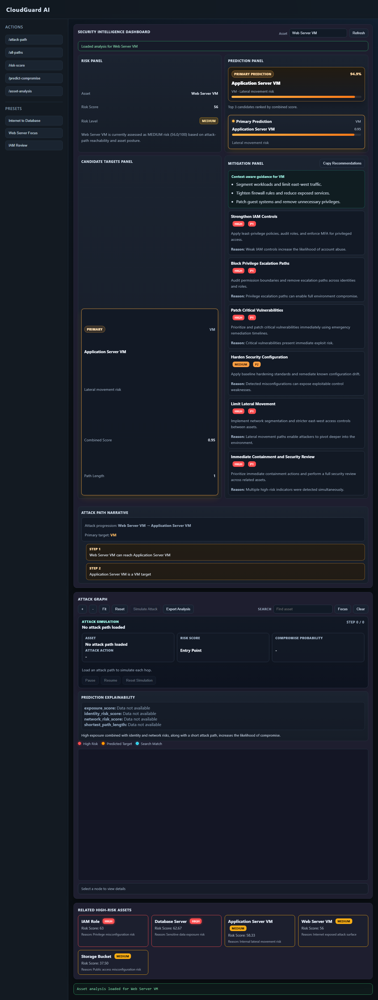
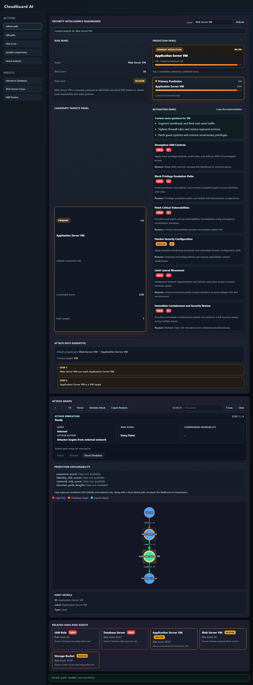
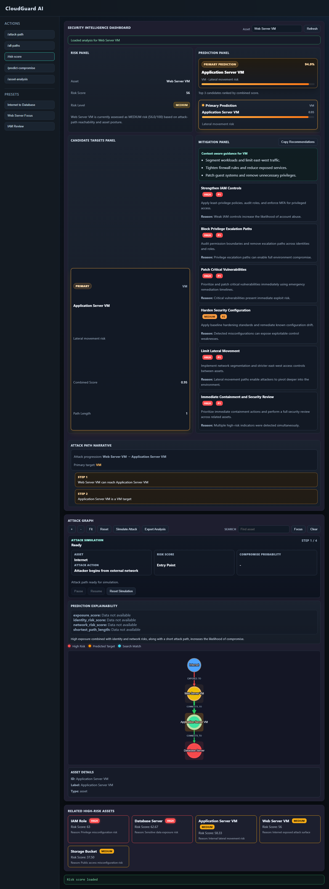
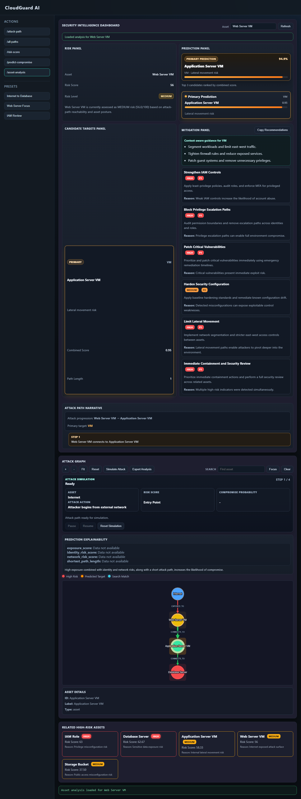

# CloudGuard AI

CloudGuard AI is a local cloud-security analysis system that combines Neo4j attack-path traversal, deterministic risk scoring, ML-assisted risk classification, next-target ranking, mitigation recommendations, and a static dashboard for portfolio and academic demonstration.

The project is designed as an end-to-end proof of concept: seed a cloud asset graph, query attack paths and risk scores through FastAPI, run model inference over asset posture features, and visualize the results in a browser dashboard.

## Key Capabilities

- Shortest attack path analysis between named cloud assets.
- All-path graph aggregation for source-to-target movement.
- Attack-risk summary with relationship-preserving graph edges.
- Ranked asset risk scoring with explanations and attack-path metadata.
- ML-based multiclass risk-level prediction (`LOW`, `MEDIUM`, `HIGH`).
- Graph/risk/model-informed next-target ranking.
- Integrated asset analysis for current risk, candidate next hops, primary predicted target, feature importance, and mitigations.
- Structured mitigation recommendations with severity, priority, and reason fields.
- Static dashboard with Cytoscape graph visualization, presets, graph search, attack simulation, risk panels, prediction panels, mitigation panels, and export support.

## Architecture

```text
User / Reviewer
  |
  v
Frontend static dashboard (frontend/index.html, frontend/js/app.js)
  |
  v
FastAPI backend (backend/app/main.py)
  |
  +--> Attack path routes (backend/app/routes/attack_paths.py)
  |      +--> Neo4j path queries (backend/app/services/attack_graph_service.py)
  |      +--> Risk scoring (backend/app/services/risk_service.py)
  |      +--> Unified response builders (backend/app/builders/response_builder.py)
  |
  +--> Prediction route (backend/app/routes/prediction.py)
  |      +--> ML inference (backend/app/ml_engine.py)
  |      +--> Next-target ranking (backend/app/services/prediction_service.py)
  |
  +--> Integrated analysis route (backend/app/routes/integrated_analysis.py)
         +--> Candidate feature construction (backend/app/integrated_analysis.py)
         +--> Mitigation engine (backend/app/mitigation_engine.py)
```

## Technology Stack

| Layer | Technology |
|---|---|
| Frontend | Static HTML, CSS, JavaScript |
| Graph UI | Cytoscape.js, vendored locally at `frontend/vendor/cytoscape.min.js` |
| Backend | Python, FastAPI, Pydantic |
| Database | Neo4j graph database |
| ML | pandas, scikit-learn, joblib, optional SHAP |
| Tests | pytest, FastAPI TestClient |

## Project Structure

```text
backend/
  app/
    routes/                 API route handlers
    services/               graph, risk, prediction, and mitigation service logic
    builders/               unified response builders
    schemas/                Pydantic schemas
    ml_engine.py            model artifact loading and inference
    integrated_analysis.py  asset-level integrated analysis
    mitigation_engine.py    rule-based mitigation recommendations
  docs/                     backend architecture and response structure docs
  tests/                    backend unit and API tests
  seed_graph.py             Neo4j demo graph seeding script

datasets/
  synthetic_attack_dataset.csv

docs/
  api_endpoint_summary.md
  limitations_future_work.md
  ml_dataset_design.md
  ml_flow_and_mitigation_logic.md
  model_evaluation_day18.md
  operations_guide.md
  screenshots/

frontend/
  index.html
  css/styles.css
  js/app.js
  vendor/cytoscape.min.js

ml/
  train_model.py

models/
  risk_model.pkl
  feature_encoders.pkl
  target_encoder.pkl
```

## API Endpoint Summary

| Method | Endpoint | Purpose |
|---|---|---|
| `GET` | `/` | Backend status message |
| `GET` | `/health` | Health check |
| `GET` | `/attack-path?start=Internet&target=Database Server` | Shortest directed path between assets |
| `GET` | `/all-paths?start=Internet&target=Database Server` | All directed paths between assets |
| `GET` | `/attack-risk-summary?start=Internet&target=Database Server` | Combined path, risk, prediction, and mitigation summary |
| `GET` | `/risk-score` | Ranked list of important assets by risk |
| `GET` | `/risk-score/{asset_name}` | Risk details for one asset |
| `POST` | `/predict-compromise` | ML risk-level prediction and next-target ranking |
| `GET` | `/asset-analysis/{asset_name}` | Integrated asset risk, candidate, prediction, and mitigation analysis |

See [docs/api_endpoint_summary.md](docs/api_endpoint_summary.md) and [backend/docs/response_structure.md](backend/docs/response_structure.md) for detailed request/response notes.

## Prerequisites

- Python 3.13 or compatible Python 3.x runtime.
- Neo4j running locally with Bolt enabled.
- A backend virtual environment with `backend/requirements.txt` installed.
- A browser for the static dashboard.

## Environment Variables

Create `backend/.env` or copy from `.env.example`:

```env
NEO4J_URI=bolt://localhost:7687
NEO4J_USER=neo4j
NEO4J_PASSWORD=password
BACKEND_PORT=8000
CLOUDGUARD_DEBUG=false
```

Update `NEO4J_PASSWORD` to match the local database.

## Setup

From the project root:

```powershell
python -m venv .venv
.\.venv\Scripts\python.exe -m pip install -r backend\requirements.txt
```

## Run Neo4j

Start Neo4j Desktop, a local Neo4j service, or a Docker-backed Neo4j instance with Bolt available at:

```text
bolt://localhost:7687
```

Confirm credentials match `backend/.env`.

## Seed the Demo Graph

```powershell
cd backend
..\.venv\Scripts\python.exe seed_graph.py
```

If the virtual environment is already active:

```powershell
cd backend
python seed_graph.py
```

## Run the Backend

From the project root:

```powershell
.\.venv\Scripts\python.exe -m uvicorn app.main:app --reload --app-dir backend
```

Backend URLs:

```text
http://127.0.0.1:8000/
http://127.0.0.1:8000/health
http://127.0.0.1:8000/docs
```

## Run the Frontend

Option 1, from the project root:

```powershell
python -m http.server 5500 -d frontend
```

Open:

```text
http://127.0.0.1:5500/
```

Option 2: open `frontend/index.html` with VS Code Live Server.

The dashboard calls the backend at `http://localhost:8000`, so the backend must be running for API-backed panels and graph rendering.

## Run Tests

From the project root:

```powershell
.\.venv\Scripts\python.exe -m pytest backend/tests
```

Some tests require Neo4j to be running and seeded. A focused post-review check is:

```powershell
.\.venv\Scripts\python.exe -m pytest backend/tests/test_attack_risk.py backend/tests/test_attack_path_routes.py backend/tests/test_mitigation_engine.py backend/tests/test_prediction_api.py
```

Latest verified result for the focused suite: `17 passed`.

## ML Flow

The model is trained from `datasets/synthetic_attack_dataset.csv` by `ml/train_model.py`. The selected model is a tuned `RandomForestClassifier` that predicts a multiclass `risk_level`. Saved artifacts live under `models/` and are loaded by `backend/app/ml_engine.py`.

See [docs/ml_flow_and_mitigation_logic.md](docs/ml_flow_and_mitigation_logic.md), [docs/ml_dataset_design.md](docs/ml_dataset_design.md), and [docs/model_evaluation_day18.md](docs/model_evaluation_day18.md).

## Screenshots

Demo screenshots are stored in [docs/screenshots](docs/screenshots). They are intended for reports, slides, and portfolio submissions.

### Dashboard Initial State



### Attack Path Visualization



### Risk Score View



### Integrated Asset Analysis



To regenerate screenshots after starting the backend and frontend:

```powershell
C:\Users\stejo\.cache\codex-runtimes\codex-primary-runtime\dependencies\node\bin\node.exe docs\capture_screenshots.mjs
```

## Limitations

- The graph and dataset are synthetic and intended for academic/demo validation.
- Risk scoring is deterministic and rule-based; it is not a production cloud risk engine.
- The ML model is trained on synthetic labels, so metrics should not be interpreted as real-world predictive performance.
- The dashboard is a local static UI, not an authenticated SaaS product.

See [docs/limitations_future_work.md](docs/limitations_future_work.md) for future improvements.

## Recommended Demo Script

1. Start Neo4j.
2. Seed the graph.
3. Start the FastAPI backend.
4. Start the static frontend server.
5. Open the dashboard.
6. Click `/attack-path`.
7. Click `/risk-score`.
8. Click `/predict-compromise`.
9. Run `/asset-analysis` for `Web Server VM`, `Database Server`, and `IAM Role`.
10. Use graph search and attack simulation for the Internet-to-Database scenario.
